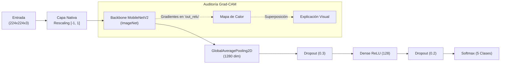

# 🌽 Diagnóstico Fitosanitario de Hojas de Maíz con Transfer Learning y Explicabilidad Visual (Grad-CAM)

[](https://www.python.org/)
[](https://tensorflow.org/)
[](https://keras.io/)
[](https://streamlit.io/)
[]()

> **ESPOL — FIEC (Facultad de Ingeniería en Electricidad y Computación)**  
> **Materia:** Inteligencia Artificial · **Grupo #1**  
> **Autores:** Ariana Palacios · Carlos Flores · Julio Guerrero  

---

## 📋 Tabla de Contenidos
- [Descripción General](#-descripción-general)
- [Características Principales](#-características-principales)
- [Patologías Diagnosticadas](#-patologías-diagnosticadas)
- [Arquitectura y Metodología](#-arquitectura-y-metodología)
  - [1. Justificación de Transfer Learning y MobileNetV2](#1-justificación-de-transfer-learning-y-mobilenetv2)
  - [2. Estrategia de Entrenamiento en Dos Fases](#2-estrategia-de-entrenamiento-en-dos-fases)
  - [3. Descongelamiento Quirúrgico y Preservación de BatchNorm](#3-descongelamiento-quirúrgico-y-preservación-de-batchnorm)
  - [4. Explicabilidad Visual (Grad-CAM)](#4-explicabilidad-visual-grad-cam)
- [Resultados y Comparativa Empírica](#-resultados-y-comparativa-empírica)
- [Estructura del Proyecto](#-estructura-del-proyecto)
- [Instalación y Configuración](#-instalación-y-configuración)
- [Guía de Uso de la Aplicación Streamlit](#-guía-de-uso-de-la-aplicación-streamlit)
- [Pruebas con Imágenes de Muestra (`examples/`)](#-pruebas-con-imágenes-de-muestra-examples)
- [Documentación del Notebook](#-documentación-del-notebook)

---

## 📖 Descripción General

Este proyecto presenta una solución integral de **visión por computador y aprendizaje profundo** para la identificación temprana y diagnóstico fitosanitario de enfermedades en cultivos de maíz (*Zea mays*). 

Diseñado específicamente para escenarios reales del sector agrícola —donde los conjuntos de datos son acotados y se requiere despliegue en dispositivos móviles o recursos computacionales moderados—, el sistema utiliza **Transfer Learning con MobileNetV2**, complementado con **Grad-CAM (Gradient-weighted Class Activation Mapping)** para mitigar el efecto de "caja negra" (*black box*) mediante mapas de calor que sustentan la decisión agronómica.

Adicionalmente, se proporciona una **interfaz web interactiva construida en Streamlit** (`main.py`) que permite a agricultores y técnicos cargar capturas de hojas afectadas en tiempo real, visualizar el diagnóstico con nivel de confianza, recibir alertas ante capturas ambiguas y auditar las áreas foliares lesionadas mediante mapas explicativos.

---

## ✨ Características Principales

- **Clasificación Multiclase Precisa:** Identifica tejido foliar sano y cuatro de las enfermedades fúngicas más destructivas del maíz con **88.27% de accuracy global** y **87.95% de F1-score macro**.
- **Preprocesamiento Embebido de Extremo a Extremo:** Las capas de aumentación (`RandomFlip`, `RandomRotation`, `RandomZoom`, brillo y contraste) y reescalado de intensidades a $[-1, 1]$ viajan integradas como capas nativas dentro del modelo serializado (`.keras`), garantizando paridad matemática exacta entre entrenamiento e inferencia.
- **Entrenamiento Robusto con Compensación de Desbalance:** Manejo de desbalance muestral mediante pesos de clase calculados exclusivamente sobre el conjunto de entrenamiento (*training-set class weights*), evitando fuga de datos.
- **Explicabilidad Visual Grad-CAM:** Inspección de los gradientes en la última capa convolucional (`out_relu`) para confirmar que el modelo enfoque lesiones patológicas (pústulas, tizones, manchas necróticas) y desestime fondos o artefactos lumínicos.
- **Interfaz Web Funcional (Streamlit):** Carga simple de archivos, visualización en 3 paneles comparativos (original, mapa de calor puro y superposición), distribución Top-3 de probabilidades y umbral de alerta automática cuando la certeza es inferior al 60%.

---

## 🍃 Patologías Diagnosticadas

El sistema clasifica cinco categorías biológicas clave:

| Clase | Agente Causal / Tipo | Sintomatología Típica |
|---|---|---|
| **Healthy** | Tejido foliar sano | Láminas verdes homogéneas, sin clorosis, pústulas ni lesiones necróticas. |
| **Common Rust** | *Puccinia sorghi* / *Puccinia polysora* (Roya) | Pústulas redondeadas a alargadas, pulverulentas de color marrón-rojizo o canela en ambas caras de la hoja. |
| **Asphalt Stain** | *Phyllachora maydis* (Mancha de Asfalto) | Manchas negras brillantes, ligeramente elevadas, con aspecto de gotas de alquitrán o brea. |
| **Bipolaris** | *Bipolaris maydis* / *Cochliobolus heterostrophus* | Lesiones alargadas, elípticas o rectangulares delimitadas por las nervaduras, con bordes castaños. |
| **Stenocarpella** | *Stenocarpella macrospora* (Mancha foliar) | Lesiones necróticas extensas, manchas pajizas o grisáceas que coalescen a lo largo de la lámina foliar. |

---

## 🧠 Arquitectura y Metodología

La versión final del modelo responde de forma rigurosa a cuatro principios fundamentales de diseño y justificación metodológica:



### 1. Justificación de Transfer Learning y MobileNetV2
- **Por qué Transfer Learning:** El dataset cuenta con **1,079 imágenes**, un volumen donde entrenar una red convolucional profunda desde cero conduce a un sobreajuste severo (*overfitting*). El aprendizaje por transferencia reutiliza los filtros primitivos (bordes, texturas, gradientes de color) entrenados sobre más de 1.2 millones de imágenes de **ImageNet**.
- **Por qué MobileNetV2:**
  - **Eficiencia y regularización:** Cuenta con ~2.3 millones de parámetros gracias a sus *convoluciones separables en profundidad*, frente a los ~25M de ResNet50 o ~138M de VGG16. Con pocas muestras, arquitecturas masivas memorizan el ruido; MobileNetV2 provee la capacidad justa.
  - **Viabilidad en campo:** Diseñada específicamente para dispositivos móviles y cómputo de borde, facilitando inferencia con latencias inferiores a 50 ms.
  - **Inverted Residual Blocks:** Retienen flujo de gradientes y características discriminativas en cuellos de botella sin degradar información espacial.

### 2. Estrategia de Entrenamiento en Dos Fases
1. **Fase 1 — Extracción de Características (Feature Extraction):**
   - **Backbone 100% congelado:** Las 154 capas de MobileNetV2 permanecen fijas (`trainable = False`).
   - Se entrena únicamente la cabeza clasificadora (~165k parámetros) durante 10 épocas con tasa de aprendizaje moderada ($\eta = 10^{-4}$).
   - **Razón:** La cabeza inicia con pesos aleatorios que emiten gradientes de gran magnitud; si el backbone estuviera activo, se destruirían las representaciones latentes preentrenadas.
2. **Fase 2 — Ajuste Fino (Fine-Tuning):**
   - Se reduce la tasa de aprendizaje ($\eta = 10^{-5}$) y se entrena durante un máximo de 30 épocas con *Early Stopping* (paciencia 5) monitoreando `val_loss`.
   - Se reentrenan únicamente los bloques convolucionales más profundos (`trainable = True`).

### 3. Descongelamiento Quirúrgico y Preservación de BatchNorm
- **Descongelamiento por nombre:** Se liberan quirúrgicamente `block_14`, `block_15`, `block_16` y `Conv_1` (19 capas liberadas de 154). Las capas iniciales se conservan intactas porque capturan propiedades visuales universales.
- **Congelamiento de `BatchNormalization`:** Sus parámetros móviles ($\mu, \sigma^2$) fueron estimados sobre el universo ImageNet. Reestimarlos con mini-lotes reducidos ($N=32$) genera perturbaciones numéricas severas; mantenerlas en modo inferencia (`trainable = False`) estabiliza el ajuste fino.

### 4. Explicabilidad Visual (Grad-CAM)
Para evitar el paradigma de caja negra:
$$\alpha_k^c = \frac{1}{Z} \sum_{i} \sum_{j} \frac{\partial y^c}{\partial A_{ij}^k}$$
$$L_{\text{Grad-CAM}}^c = \text{ReLU}\left(\sum_{k} \alpha_k^c A^k\right)$$
Se obtienen las ponderaciones $\alpha_k^c$ promediando globalmente los gradientes de la puntuación $y^c$ respecto a los mapas $A^k$ de la capa `out_relu`. La función $\text{ReLU}$ retiene exclusivamente las activaciones que influyen positivamente hacia la patología diagnosticada.

---

## 📊 Resultados y Comparativa Empírica

### Validación de la Hipótesis de Transferencia
Para validar con evidencia numérica la necesidad de MobileNetV2, se contrastó contra una CNN diseñada y entrenada desde cero con idéntica aumentación de datos y balanceo de pesos:

| Modelo | Accuracy en Test | F1-Score Macro | Observación |
|---|:---:|:---:|---|
| **Baseline CNN (Desde Cero)** | 40.12% | 34.79% | Falla severa por escasez de datos |
| **MobileNetV2 (Propuesto v5)** | **88.27%** | **87.95%** | **Ganancia de +48.15 puntos de Accuracy** |

### Búsqueda de Hiperparámetros (Sin Fuga de Datos)
Se evaluó el número óptimo de bloques profundos a descongelar evaluando **exclusivamente sobre el conjunto de validación** (protegiendo el conjunto de prueba para la evaluación final):

| Configuración | Bloques Liberados | val_accuracy | val_loss | Estado |
|---|:---:|:---:|:---:|:---:|
| `ultimo_1_bloque` | block_16 + Conv_1 | 85.80% | 0.3706 | Sub-adaptado |
| `ultimos_5_bloques` | block_12 al 16 + Conv_1 | 90.12% | 0.2824 | Mayor varianza |
| **`ultimos_3_bloques`** | **block_14 al 16 + Conv_1** | **90.74%** | **0.3134** | **Ganador Seleccionado** |

### Reporte de Clasificación en el Conjunto de Prueba (Test Set — 162 imágenes)

```
               precision    recall  f1-score   support

      healthy     0.9211    1.0000    0.9589        35
stenocarpella     0.9091    0.8824    0.8955        34
    bipolaris     0.8182    0.8182    0.8182        33
  common_rust     0.8056    0.9667    0.8788        30
asphalt_stain     1.0000    0.7333    0.8462        30

     accuracy                         0.8827       162
    macro avg     0.8908    0.8801    0.8795       162
 weighted avg     0.8908    0.8827    0.8812       162
```

---

## 📁 Estructura del Proyecto

```text
proyecto-IA-ESPOL/
├── README.md                      # Documentación general del repositorio
├── requirements.txt               # Especificación de dependencias del entorno
├── main.py                        # Aplicación web en Streamlit (interfaz gráfica)
├── models/
│   ├── best_maize_model_v1.keras  # Histórico iteración inicial
│   ├── best_maize_model_v2.keras  # Histórico iteración intermedia
│   └── best_maize_model_v5.keras  # Modelo final seleccionado y en producción
├── notebook/
│   ├── README.md                  # Documentación técnica exhaustiva del notebook
│   └── ProyectoIA_v5.ipynb        # Cuaderno Jupyter con pipeline de entrenamiento
└── examples/                      # Muestras foliares reales para testeo rápido
    ├── asphalt-stain/             # Imágenes de prueba: Mancha de Asfalto
    ├── bipolaris/                 # Imágenes de prueba: Bipolaris
    ├── common-rust/               # Imágenes de prueba: Roya Común
    ├── healthy/                   # Imágenes de prueba: Hojas Sanas
    └── stenocarpella/             # Imágenes de prueba: Stenocarpella
```

---

## ⚙️ Instalación y Configuración

### 1. Clonar el repositorio
```bash
git clone https://github.com/julioguerrero131/proyecto-IA-ESPOL.git
cd proyecto-IA-ESPOL
```

### 2. Crear y activar un entorno virtual
- **En Windows (PowerShell):**
  ```powershell
  python -m venv venv
  .\venv\Scripts\Activate.ps1
  ```
- **En Linux / macOS:**
  ```bash
  python3 -m venv venv
  source venv/bin/activate
  ```

### 3. Instalar las dependencias
```bash
pip install --upgrade pip
pip install -r requirements.txt
```

---

## 🖥️ Guía de Uso de la Aplicación Streamlit

Para desplegar la aplicación web localmente, ejecuta en la terminal:

```bash
streamlit run main.py
```

El navegador abrirá automáticamente la dirección local `http://localhost:8501`.

### Flujo de Trabajo en la Interfaz:
1. **Cargar Imagen:** Pulsa sobre *"Elige una imagen..."* o arrastra un archivo en formato `.jpg`, `.jpeg` o `.png`.
2. **Inferencia Automática:** El sistema aplica el decodificador `tf.io.decode_image` (sin pérdidas), redimensiona a $224 \times 224$ px y calcula los gradientes Grad-CAM en milisegundos.
3. **Lectura de Resultados:**
   - **Diagnóstico:** Indica la patología inferida y el porcentaje de confianza.
   - **Protocolo de Baja Certeza:** Si la probabilidad máxima es inferior al **60%**, la interfaz emite una alerta amarilla recomendando repetir la captura a una distancia focal de 15–20 cm bajo iluminación homogénea.
   - **Panel de Explicabilidad Visual:**
     - *Panel 1:* Captura original estandarizada.
     - *Panel 2:* Mapa de activación puro (mapa de calor colormap `jet`).
     - *Panel 3:* Fusión ponderada ($\alpha=0.45$) entre la hoja y el mapa explicativo.
   - **Distribución Top-3:** Despliegue interactivo con barras de progreso que detalla las probabilidades relativas de las 3 clases principales.

---

## 🧪 Pruebas con Imágenes de Muestra (`examples/`)

El repositorio incorpora la carpeta `examples/` con casos de prueba listos para usar:

1. Inicia la app (`streamlit run main.py`).
2. Haz clic en el botón de carga de archivos.
3. Entra a `examples/` y selecciona cualquier subcarpeta:
   - `examples/asphalt-stain/asphalt_stain_002.jpg`
   - `examples/bipolaris/bipolaris_006.jpg`
   - `examples/common-rust/common_rust_001.jpg`
   - `examples/healthy/healthy_001.jpg`
   - `examples/stenocarpella/stenocarpella_001.jpg`
4. Observa cómo el mapa de calor localiza con precisión las áreas foliares con presencia de pústulas o necrosis.

---

## 📓 Documentación del Notebook

Para profundizar en la formulación matemática de Grad-CAM, la carga mediante generadores `tf.data`, las curvas de aprendizaje y la trazabilidad de código paso a paso, consulta el documento técnico especializado:

👉 **[Ver Documentación del Notebook (`notebook/README.md`)](notebook/README.md)**

---

## 👥 Créditos y Autores

Proyecto desarrollado en la **Escuela Superior Politécnica del Litoral (ESPOL)** para la materia de **Inteligencia Artificial**:

- **Ariana Palacios**
- **Carlos Flores**
- **Julio Guerrero**